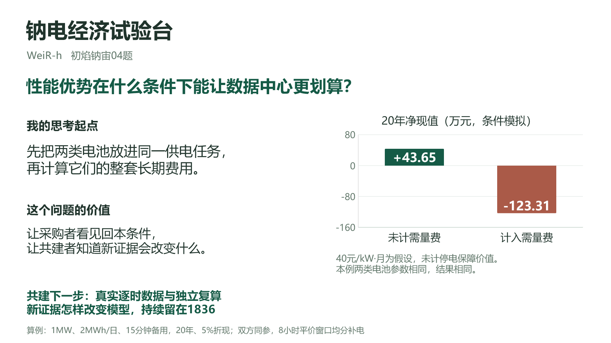

# 钠电经济试验台

作者：**WeiR-h**。面向初焰·钠宙04题的本地研究工具。

在相同AI数据中心供电任务下，比较钠电与磷酸铁锂的长期费用，并检查充电窗口、购电峰值和备用电量是否允许完成任务。

当前版本：工具 **0.3.4**，经济模型 **0.2.0**，正式研究 **v1.3**，单页路演 **v1.4**。94项自动检查通过；正式便携包重新解压后复验通过。真实现场数据、同任务有效配对报价及真实独立复核仍待补齐。

[1836共建更新](https://1836.online/posts/cmvb1eqov00yq3koaf6y7gew6) · [04题](https://1836.online/projects/cmujvb96f000z3jo188jx0xjp)



## 三个可复算案例

在“研究概览”中一键运行，每个案例使用独立输入，不覆盖正在编辑的场景。

| 案例 | 共同参数演示结果 | 说明 |
|---|---|---|
| 不计需量费 | 项目净现值约 +43.65万元 | 充放电与备用约束均满足 |
| 需量费40元/kW·月 | 项目净现值约 −123.31万元 | 40元为压力测试，不代表实际电价合同 |
| 充电窗口仅1小时 | 任务不可行 | 不输出胜者或采购分界 |

前两例中，两条路线在共同参数下各自得到相同数值。这些数值不是钠电相对磷酸铁锂的差额，也不是现场实测年度收入。

## 运行

需要Node.js 22.12或更新版本。本地计算不需要模型API、账户或GPU。

使用已构建的工具：

```sh
node scripts/serve.mjs
```

打开 http://127.0.0.1:4176 。便携包也可双击“启动工具.cmd”。端口被占用时运行`node scripts/serve.mjs --port 4177`。

开发与验证：

```sh
npm ci
npm run dev
npm run build
npm test
node scripts/build-sprint-evidence.mjs
```

## 研究与路演材料

- [14页研究报告PDF](output/pdf/AIDC-Na-LFP-Research-v1.3.pdf) 与 [研究正文](docs/research-v1.3-2026-10-16.md)
- [单页可编辑PPT](output/presentation/AIDC-Na-LFP-Roadshow-v1.4-final.pptx) 与 [9分钟主体讲稿、5个问答](docs/roadshow-script-v1.4-2026-10-16.md)
- [本轮版本说明](docs/version-log-2026-10-16.md)
- [真实数据案例模板](docs/field-case-v1.4-template.md)：研究v1.4现场案例仍待实际资料

路演准备按已核对的10分钟讲述、5分钟交流、仅1页PPT要求制作。主体目标9分钟、1分钟机动，实际时长需真人排练。

## 数据接入与共建

新增带时区CSV：`timestamp,load_kw,price`，单位为kW和元/kWh。导入先预览，展示覆盖日期、完整日、缺失、重复和异常；首批计算仅使用完整整小时记录，不自动补零或平均不支持的时间粒度。

完整日回放保留输入和能量账本，只替换该日负荷与电价。共建记录可关联具体计算，保存修改前后结果及复核记录，并按分享范围导出1836摘要。旧版资料迁移保留历史；更正不覆盖旧记录。

`data/time-series-sample-not-field.csv`与`evidence/sprint-v0.3.4`是明确标注的合成样例与流程演练。软件中的署名检查不认证真实身份，也未连接1836审核、积分或资金结算接口。私有资料默认仅本地使用，社区输出遵循资料提供方许可。

## 模型与证据边界

- 经济模型0.2.0公式保持不变，原模型文件与0.3.0版的校验见[evidence/sprint-v0.3.4/model-integrity.json](evidence/sprint-v0.3.4/model-integrity.json)。
- 同任务比较采用交流侧相同功率、可交付电量和备用要求；低温、效率、寿命等字段按各自证据状态标注。
- 长期测算使用重复24小时代表日假设，不代表真实全年调度，也未证明全局最优。单日或少量样本仅支持对应日期的运行分析。
- 需量费按增量实际峰值与代表日每月出现的假设计算，不直接适用于容量计费、合同保底或低频调度。
- 未计税费、融资、停电损失与真实UPS切换价值。采购分界仅改变钠电初始电池单价，不能解释为完整系统报价。
- 任务未满足时不输出方案胜负；演练积分、分配预演和模型收益不等于正式积分、实际收入或资金支付。

完整假设、产品规格和历史采购证据见研究正文与`evidence/product-prices-2026-10-14`。历史价格不能替代当前同任务有效配对报价。

## 参与和许可

提交来源、数据使用范围、计算版本和结论影响，按[贡献说明](CONTRIBUTING.md)申请复核。软件验证不能替代产品实验或现场验证。

原创应用源码、脚本与测试采用[MIT许可](LICENSE)。第三方规格书、原始网页和数据保留原来源权利；软件依赖许可见[THIRD-PARTY-NOTICES.txt](THIRD-PARTY-NOTICES.txt)。代码许可不承诺收益权益。