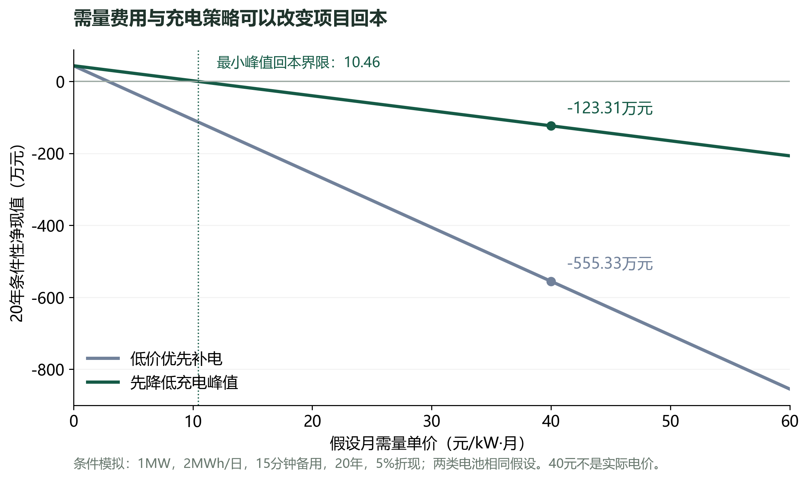
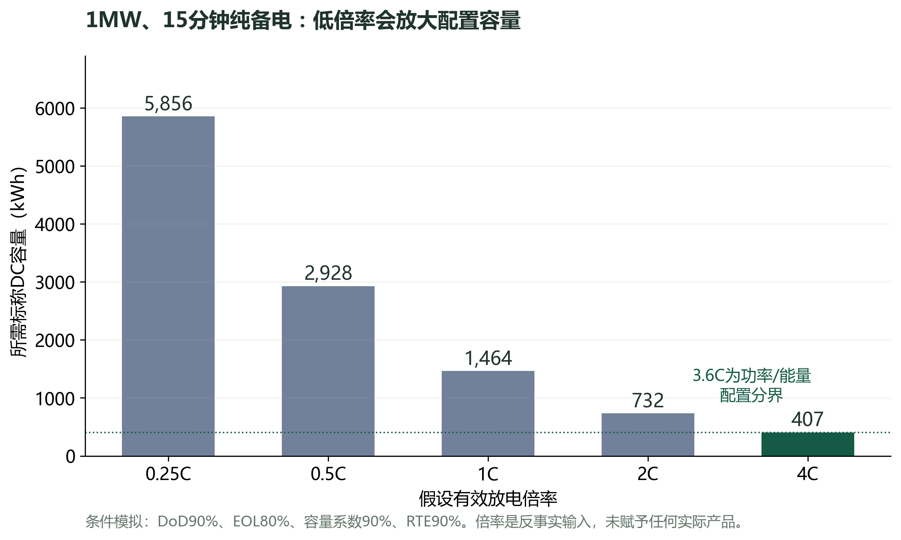
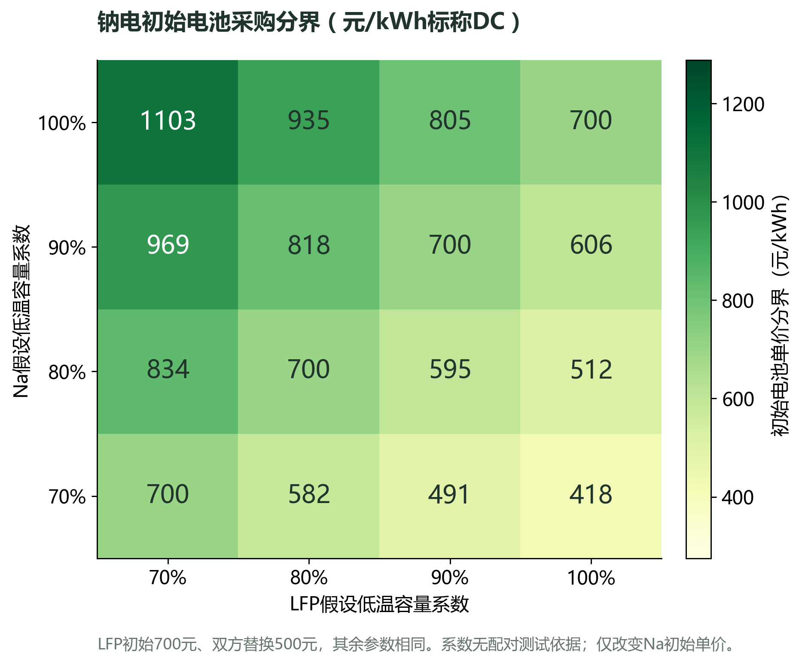

# 钠电与磷酸铁锂在AIDC中的长期经济边界研究

第一版研究 · 2026年10月14日 · 初焰钠宙04题 · 模型0.2.0

作者署名待本人复核。GPT辅助检索、资料核对、模型开发与文字整理。研究材料已在本地生成，尚未在1836发布。本版为条件性模拟研究，未取得两类产品同工况测试、同供货边界报价和真实AIDC负荷。

## 摘要

本研究把“哪种电池更便宜”转换为一个可检验的问题：在相同交流侧功率、交付电量与备用要求下，钠电的采购溢价，需要由哪些性能或运行收益抵消？我们建立了容量配置、逐时运行、循环与日历约束、替换现金流和采购边界连通的模型，覆盖官方要求的五项经济比较。主模型暂按两类系统共同满足15,000次循环和−30℃正常充放电解释题设，另保留仅钠电满足循环条件的对照。[04题说明](https://1836.online/projects/cmujvb96f000z3jo188jx0xjp)

以1MW负荷、每日2MWh交付、15分钟备用、20年和5%折现率为演示条件，得到四个结果。第一，相同技术与费用假设下，两类系统的成本相同，题设本身没有产生钠电价格优势。第二，在平坦谷价窗口摊平充电后，加入40元/kW·月的假设增量需量计费，净现值从＋43.65万元变成-123.31万元。第三，15分钟纯备电若只有0.5C放电能力，需要2928kWh标称配置；4C假设下为407kWh，功率能力可以比每kWh价格更重要。第四，本场景年测试等效循环为233.6次，15年日历约束先于15,000次耗尽；即使LFP独立设为6,000次，也不改变第15年换电。

因此，本版不作现实采购胜者判定，而给出可以被数据推翻的决策边界。首先确认供电任务可行，再确认计费方式与收益能否覆盖系统成本，最后比较两类产品的同口径报价。当前最有价值的后续证据是低温倍率与容量、日历质保、含税供货边界及按月真实需量。

## 1 问题与官方要求

04题明确要求比较初始投入、运维、替换、能效和长期收益，并建立可复用经济模型。现行评审重视过程、思考方式留痕与原创性，同时综合平台项目集合及路演；每组20分钟，仅1页PPT。官方没有给出详细打分比例。[现行规则](https://1836.online/points-and-revenue)

本研究提出三个可证伪假设：H1，相同供电任务下，低温能力减少的配置及运行费用可能抵消钠电初始溢价；H2，高循环寿命只有在循环老化先于日历老化时才减少换电；H3，满足备用约束的日内电量搬移不一定带来正净现值，充电峰值费用可能使结果反转。

15,000次测试的温度、倍率、DoD和容量终点未写入题目；−30℃也未区分外部环境、电芯温度及系统预热。正常充放电不等于没有功率、效率或容量损失。这里使用两个独立输入：题设运行边界，以及显式假设的容量、倍率与效率，避免拼接成未经证实的低温寿命承诺。

同题公开研究已经讨论备用、日常电费优化、需量及功率约束。本版在这些共同问题上独立实现逐时账本、可行性拦截、增量需量反例和短时备电倍率边界；不把通用DCF或LCOS方法宣称为学术首创，也不把其他参赛者资料作为规则或产品证明。[同题第四天讨论](https://1836.online/posts/cmv3eakqr00kg3kpmflyzdcm2)、[第五天讨论](https://1836.online/posts/cmv3edx8z00km3kpm5mh9cpg3)

## 2 资料核对与参数准入

| 来源 | 可以支持的判断 | 不能直接作为的输入 |
| --- | --- | --- |
| 官方04题 | 15,000次和−30℃研究条件、五项比较 | 测试DoD、EOL、绝对效率与报价 |
| DOE 2022方法 | 循环与日历寿命、更换、退役的成本结构 | 中国2026年采购价格 |
| 宁德时代2026钠电公告 | 厂商25℃循环与−20℃容量披露 | −30℃寿命、配对RTE、短时备电倍率 |
| 宏英智能2026投资者记录 | 公司对当前与理论电芯成本的判断 | AIDC系统成交价、降价兑现年份 |
| Nature Energy 2025研究 | 材料、能量密度和供应链影响电芯竞争力 | AIDC系统收益、UPS服务费用 |
| IEA 2026分析 | 低温应用潜力与产业成熟度约束 | 本项目配对性能和采购价 |
| 台达LBM产品说明 | LFP也有10—30分钟备电产品 | 4C、−30℃倍率或本项目价格 |

宁德时代披露的15,000次循环对应25℃，低温容量保持数据对应−20℃；二者不能合并成为−30℃下15,000次。其辅源功耗百分比与系统RTE改进有不同计量边界，本版没有把它们转换成绝对效率或每天耗电输入。[宁德时代公告，2026年6月23日](https://www.catl.com/news/10052.html)

宏英智能7月24日投资者记录第3页称，当前钠电电芯成本高于LFP，并提出理论长期降本判断。这是公司陈述，比较对象为电芯成本。不能把其40%—50%或理论低30%直接套用到整套AIDC采购预算。[原始记录](https://static.cninfo.com.cn/finalpage/2026-07-24/1225441968.PDF)

Yao等2025年研究关注电芯价格，指出竞争力依赖工程发展与供应链条件，且明确不覆盖系统集成和性能带来的系统价值。IEA在2026年分析了低温机会与成本约束。两项资料支持进行条件分析，未给出本研究输入的厂商背书。[Nature Energy原文](https://www.nature.com/articles/s41560-024-01701-9)、[IEA分析](https://www.iea.org/commentaries/sodium-ion-battery-momentum-grows-but-challenges-remain)

短时备电对照需要选择相应产品。台达LBM的公开用途为10—30分钟备电，说明LFP对照不能自动用低倍率长时电站电池代替。[台达产品说明](https://www.deltapowersolutions.com/en/mcis/lbm-series-ups-battery-system-introduction.php)

所有计算性能、价格和负荷输入仍为假设。完整准入记录在data/source-audit.json，记录来源日期、支持范围及被排除的映射。任丘不同规模4小时候选设备价格未取得原始配对供货边界，本版未纳入。

## 3 系统边界与经济方法

比较单位为完成同一交流侧任务的系统。P为保护及调度功率，Q为每天日常交付电量，t为备用小时，R=P×t为备用交流电量。往返效率ηRT按对称路径拆为ηc=ηd=√ηRT；这是模型假设。

设DoD为可用放电深度，fEOL为寿命终点容量比例，fT为设计条件容量系数，Cd为在该条件与EOL下可用容量基础上的放电倍率，则标称DC容量为：

E能量=(Q+R)/(DoD×fEOL×fT×ηd)

E功率=P/(Cd×fEOL×fT×ηd)

E标称=max(E能量,E功率)

备用占用DC能量R/ηd，运行过程中保持不低于这一预留。模型按EOL配置并一直用EOL可用容量检查运行，没有预测真实衰减轨迹。功率公式的Cd是模型有效倍率；厂商按初始Ah定义的C值不能未经换算直接输入。

逐时账本满足：存储DC变化=充电交流电量×ηc−交付交流电量/ηd。购电=负荷＋充电＋辅助用电−放电，受PCS、充电倍率、负荷和购电上限约束。充电只在前段窗口，放电只在后段窗口；不向电网出售电量，不在同小时充放电。日末回到备用水平，日初备用首次补电费用计入初始投入。任务不足时停止输出采购胜负和报价边界。

模型提供低价优先及先降低充电峰值两种策略。后者对充电峰值上限做单调可行性搜索，再在该上限内按低价优先填充。在本研究平坦谷价、相同负荷、固定Q的窗口中，所需平均补电功率给出峰值下界，均匀补电达到它；因此压低峰值不增加能量费。谷段价格不同时，两种策略不代表完整经济最优；后续需使用包含电量费及月需量的联合优化。

年测试等效循环n=年交流交付量/(ηd×E标称×循环测试DoD)。循环支持年数=N/n，换电间隔=min(日历寿命,N/n)。这是线性吞吐量假设，未做电化学老化校准。更换按精确发生时点折现，项目期末不再重复采购。

TCO=C初始＋年度充电、辅助用电、增量需量和运维的现值＋电池及PCS更换现值＋退役减残值现值。NPV=避免购电费用现值−TCO。LCOS=TCO/折现日常交付量；纯备用没有日常放电量时不输出LCOS。评价结构参考DOE，但参数由本场景显式给定。[DOE方法说明](https://www.energy.gov/cmei/2022-grid-energy-storage-technology-cost-and-performance-assessment)

需量项按实际峰值计费的简化结构计算：年增量费用=12×月需量单价×(有储能购电峰值−无储能负荷峰值)。假定代表日峰值每个月出现，不适用于变压器容量计费、合同保底门槛或少数月份调度的直接估算。历史官方资料说明这些计费方式存在区别；本版40元仅为压力测试，不代表2026年某地现行价格。[国家发改委计费结构说明](https://zfxxgk.ndrc.gov.cn/web/iteminfo.jsp?id=16504)

采购分界pNa*=(LFP的TCO−钠电除初始电池采购以外的现值费用)/钠电标称容量。仅改变钠电初始电池相关单价；替换单价固定，不是含税交钥匙系统报价。相对费用较低和项目自身回本是独立判断。

## 4 统一演示输入

| 共同场景参数 | 数值 | 性质 |
| --- | --- | --- |
| 负荷与PCS额定功率 | 1,000kW，全天平坦负荷 | 假设 |
| 日常交付与备用 | 2,000kWh/日；15分钟即250kWh | 假设 |
| 项目期限与实质折现率 | 20年，5%，不变价 | 假设 |
| 调度与窗口 | 365天/年；0—8点充电，之后放电 | 假设 |
| 电价 | 0—8点0.30；8—16点0.55；16—22点0.85；22—24点0.55元/kWh | 合成电价 |
| 购电上限 | 2,200kW | 假设 |
| DoD、EOL、测试DoD | 90%、80%、90% | 假设 |
| PCS单价与寿命 | 200元/kW；15年 | 假设 |
| 其他建设、每次换电附加、退役 | 18万元、2万元、2万元；残值0 | 假设 |

| 两类系统相同的电池输入 | 数值 | 性质 |
| --- | --- | --- |
| 初始电池相关单价／替换单价 | 700／500元/kWh标称DC | 假设，PCS及其他费用另列 |
| 往返效率／容量系数 | 90%／90% | 有效条件假设 |
| 充电／放电倍率 | 0.5C／0.5C | 有效条件假设 |
| 日历寿命／年运维／日辅助耗电 | 15年／2万元／32kWh | 假设 |
| 循环寿命 | 主模式双方15,000次 | 题设解释 |

−30℃是设计运行边界，未模拟全年恒定低温。电芯实际温度、预热、机房恒温和热损耗未建模。实际对照应同时评估冷端部署和恒温机房路线，不能把室外无预热LFP与恒温系统的标称性能混在一起。默认输入是对称控制组，便于检查模型是否人为偏向某一技术。

## 5 结果一 需量费用与调度改变项目回本

| 兼用场景 | 购电峰值kW | TCO万元 | NPV万元 | LCOS元/kWh |
| --- | --- | --- | --- | --- |
| 无需量费用，低价优先 | 2,001.3 | 729.63 | ＋43.65 | 0.802 |
| 无需量费用，最小充电峰值 | 1,279.1 | 729.63 | ＋43.65 | 0.802 |
| 需量40，低价优先 | 2,001.3 | 1,328.61 | −555.33 | 1.460 |
| 需量40，最小充电峰值 | 1,279.1 | 896.59 | −123.31 | 0.986 |

数字对两类系统相同。费用现值分解为：初始294.21万元、充电与辅助用电311.13万元、运维24.92万元、更换98.61万元、退役0.75万元。在最小峰值策略和需量40时，新增需量现值166.96万元，其余费用保持相同。

本窗口充电价格完全相同，均分充电将增量峰值从1,001.3kW降至279.1kW，相对低价优先降低20年费用现值432.02万元。这是特定窗口下的调度价值，不是钠电材料独有价值。按上述条件，最小峰值策略的需量单价回本界限约10.46元/kW·月；实际合同应代入重新计算。需量40条件下，还需每年9.89万元等值、持续20年的额外净收益才能回本。这是需求值，不是已经实现的调频或避免停电收入。

## 6 结果二 短时备电先看功率

纯备电设Q=0、调度天数0，仍保留1MW、15分钟、共同成本与EOL条件。0.5C下，标称容量2928.0kWh，由放电功率配置决定；4C假设下，标称容量406.7kWh，由备用能量决定。两者年化整体费用分别286.9和96.6元/kW·年。没有为任一真实产品赋予0.5C或4C认证。

令E功率≤E能量，得到纯备电能量约束主导的倍率门槛Cd≥DoD/t。15分钟与90%DoD对应3.6C。若Cd更低，按每kWh单价比较会遗漏功率导致的配置放大。该简化公式没有描述高倍率电压跌落、容量变化与热约束，门槛需要实际放电曲线复核。

备用LCOS为空。即便模型储能能量足够，也不能判定真实UPS切换合格；冗余、直流母线、控制接口、安全和可靠性需要工程验证。年化费用表示购买保障能力的条件性成本，不是停电保障的市场价值。

## 7 结果三 15,000次不自动形成更换优势

基准场景年测试等效循环233.6次，15,000次对应的次数换算为64.21年，但假设日历寿命15年先触发换电。这个64.21年不是使用寿命预测。

| LFP独立循环输入 | 循环换算年数 | 实际模型换电间隔 | 钠电初始电池单价分界 |
| --- | --- | --- | --- |
| 3,000次假设 | 12.84年 | 12.84年，循环限制 | 726.99元/kWh |
| 6,000次假设 | 25.68年 | 15年，日历限制 | 700.00元/kWh |
| 15,000次题设解释 | 64.21年 | 15年，日历限制 | 700.00元/kWh |

在年测试等效循环233.6次、日历寿命15年的假设下，循环约束门槛为3,504次。对照高于这一门槛时，提高循环次数不会减少该模型的换电事件。3,000次情景仅是反事实测试；不能作为LFP行业性能。换电价格、日历衰减与质保条款的真实差异仍可能改变结果。

## 8 结果四 低温优势对应有条件的采购分界

保持其他参数及替换价格相同，仅设Na容量系数0.9、LFP0.7，钠电标称配置为3,660.0kWh，对照为4,705.8kWh；钠电初始电池费用分界升至968.72元/kWh，相对LFP700元假设可容纳38.4%溢价。这是配置与未来替换数量共同作用的结果。0.9与0.7不是取得的配对实验数据；若LFP通过温控维持较高容量，则需要重新加入温控投资、耗电和充电性能，不能沿用该优势。

432个限定条件组合覆盖Na初始560/700/840/1050元、RTE85/90/95%、容量系数70/80/90/100%、日历10/15/20年，以及LFP容量系数80/90/100%；其余参数固定，需量40，采用最小峰值策略。全部完成本模型日交付，Na−LFP费用差从−233.38到＋375.14万元，采购分界从275.28到1,287.91元/kWh。网格未拟合联合分布，忽略部分物理相关性，不将格点占比解释为现实胜出概率。

## 9 反例与验证

将充电窗口压缩为1小时，PCS最多补入1,000kWh交流电，90%往返效率下只能交付900kWh，少于2,000kWh任务。模型仍保存部分运行费用用于排错，但不输出采购胜者、利润结论或分界。多买电池无法自动解决PCS和充电窗口的约束。此工况所需补电时间下界为2,000/(0.9×1,000)=2.22小时，逐时模型至少需要3个完整小时窗口。

模型的47项软件检查覆盖独立小规模手算、能量守恒、备用不被侵占、功率及购电上限、不可行拦截、替换与折现时点、旧场景兼容、增量需量费、最小峰值平价解析解及分界反转。研究批处理另设6项结论一致性断言。软件检查证明这些计算规则的一致性，不能验证厂商数据、低温性能与现场经济性。

独立手算采用100kWh电池、10元/kWh初始价、每年一次、两年零折现，其他费用为零：每次充电30元、避免购电85元，总费用1,060元、总避免费用170元、NPV−890元、LCOS5.3元/kWh。将共同参数设成完全相同，则两类方案费用差应为0。完整逐时与逐年文件保留未四舍五入值，图表与正文仅作显示舍入。

## 10 三轮迭代与AI辅助方式

三轮均在2026年10月14日实际完成，不回填为先前日期的公开研究。第一轮核对官方题目和现行规则，建立参数准入表，收紧“温度×循环寿命”“电芯成本×系统采购”“辅源百分比×绝对效率”的映射。第二轮增加增量需量费、最小充电峰值策略、容量约束解释与备电年化费用，并得到回本反转与倍率反例。第三轮运行11个完整场景和432格条件分析，交叉检查公式，整理图表、首版研究及单页讲述。

GPT用于发现待核问题、检索资料、编写模型与测试和整理表达。数值由确定性计算代码产生，关键条件由原始资料与独立解析算例核对。没有训练新材料模型，没有接入实时LLM作电池控制，也没有把生成式模型的回答作为电池实验结果。本人需审读署名、动机与最终公开陈述。

## 11 验证优先级与下一版判据

| 优先级 | 需要的数据与方法 | 将改变哪项结论 |
| --- | --- | --- |
| 1 | 组委会澄清题设对象、DoD、EOL、−30℃含义 | 固定共同或单方主解释 |
| 2 | 同功率及备电任务的两份含税报价，列明电池、柜、BMS、PCS、温控和施工 | 把700元演示分界转换为实际采购比较 |
| 3 | 同产品EOL与实际电芯温度下的放电曲线、充电限制、容量及RTE，明确辅源是否已含 | 复核短时倍率门槛、装机与低温溢价 |
| 4 | 日历质保、容量终点及循环DoD、倍率、温度；更换停机与价格条款 | 替换周期与未来费用 |
| 5 | 至少12个月按15分钟记录的AIDC负荷、电价、实际计费峰值及合同方式 | 替代代表日、联合调度和真实需量项 |
| 6 | 温控与维保日志、UPS冗余与切换试验；实际服务收入合同 | 确认可用率与可叠加收益，防止重复计价 |

下一版仅在取得对应证据后把该项从“假设”升级为“产品资料”或“现场测量”。目前不估计停电概率及算力收入，不以电池材料安全宣传推导故障率，也没有税费、融资、土地占用与退役合规费用校准。研究的范围是决策筛选与可复算边界。

## 12 官方要求对应与提交材料

| 官方要求 | 本版交付 | 当前状态 |
| --- | --- | --- |
| 两类系统、五项长期经济比较 | 第3—8节；逐年现金流与费用拆分 | 本地完成，条件模拟 |
| 15,000次与−30℃ | 主模型及单方解释对照、参数准入表 | 纳入；测试口径待澄清 |
| 可复用经济模型 | 可运行工具、JSON/CSV输入、模型与复算脚本 | 本地完成 |
| 过程与原创问题留痕 | 当日三轮记录、修正理由与反例、三篇发布草稿 | 草稿完成；未发布 |
| 20分钟仅1页PPT | 一页可编辑PPTX与另存讲述提纲 | 本地材料；场次和演示权限待通知 |
| 平台项目集合查阅 | 研究、代码与证据包准备就绪 | 需发布、确认审核及集合归属 |

按现行规则，10月15日零点确定分组，10月17日零点把平台已发布内容归集到各组项目集合。准备计划按北京时间10月14日晚完成分组确认、10月16日晚完成发布与收录核对；官网未单独标注时区，场次以组委会通知为准。完整PDF或一页PPT不能代替平台研究过程留痕。平台积分公式也不能当作评委票数。[规则来源](https://1836.online/points-and-revenue)

复算顺序：运行工具包或项目scripts/serve.mjs查看场景；运行scripts/build-evidence.mjs生成控制组账本，再运行scripts/build-research.mjs与scripts/build-report.mjs生成研究数据和正文。evidence/research-v1中的11个JSON含输入与完整输出；case-summary.csv及五组敏感性CSV可单独检查。data/source-audit.json保存资料准入边界。源代码包与便携工具包保留0.1历史版本另存0.2，正式研究采用0.2。

## 结论

现有证据支持钠电在低温应用中值得研究，尚不足以确认其在本AIDC采购任务中必然优于LFP。长循环寿命何时有价值、低温能力允许多少溢价、日内价差是否被需量费抵消，都可以由明确任务、报价、性能和合同代入检验。本版提供了三个解析边界、一个不可行反例和可运行模型；下一步优先取得能改变边界的配对资料。
